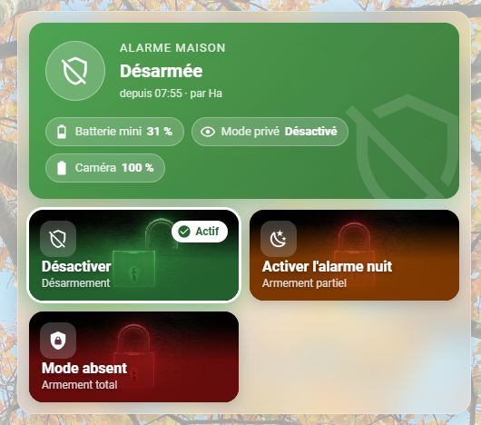
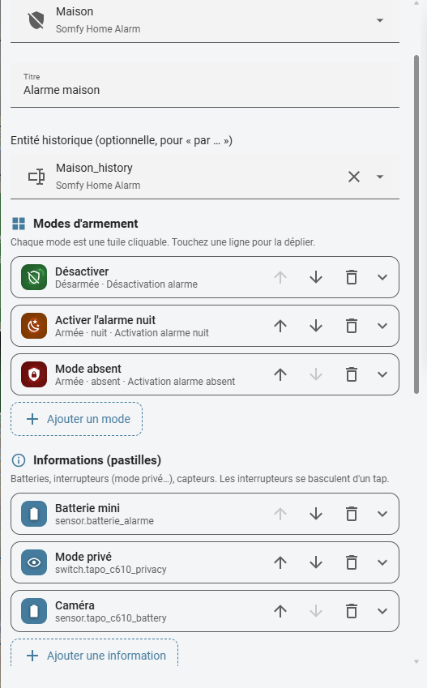

# Customizable Alarm Card

*[English version](README.md)*

Carte Lovelace pour piloter une alarme `alarm_control_panel`, avec un éditeur visuel complet.

- **Bandeau d'état** coloré selon l'état (désarmée, nuit, absent, armement, déclenchée…), avec animation de pulsation quand l'alarme est armée et clignotement si elle est déclenchée. Affiche « depuis 15:36 · par Ha ».
- **Pastilles d'information** : batteries (icône et alerte selon le niveau), interrupteurs basculables d'un tap (mode privé caméra…), n'importe quel capteur.
- **Tuiles de modes** illustrées (image de fond + dégradé de couleur), badge « Actif » sur le mode en cours, spinner pendant l'armement, confirmation optionnelle par double tap.
  Chaque mode lance une scène, un script ou un bouton, ou pilote directement l'alarme (avec pavé de code si l'alarme en demande un).
- **Aperçu caméra** optionnel, flouté quand le mode privé est actif.
- **Éditeur visuel** : sections Général / Modes / Informations / Caméra / Apparence, ajout, suppression et réordonnancement des modes et des pastilles, couleurs par état.

L'interface est disponible en français et en anglais (elle suit la langue de Home Assistant).

## Captures d'écran





## Installation

### HACS (dépôt personnalisé)

1. HACS → menu ⋮ → *Dépôts personnalisés* → ajoutez `https://github.com/Ergorock/customizable-alarm-card`, catégorie **Dashboard**.
2. Installez **Customizable Alarm Card**, puis rechargez le navigateur.

### Manuelle

1. Copiez `customizable-alarm-card.js` dans `config/www/customizable-alarm-card.js`.
2. *Paramètres → Tableaux de bord → ⋮ → Ressources* : ajoutez `/local/customizable-alarm-card.js?v=1.0.0` (type *Module JavaScript*).

Après une mise à jour du fichier, incrémentez `?v=` dans l'URL de la ressource pour vider le cache.

## Exemple de configuration

```yaml
type: custom:customizable-alarm-card
entity: alarm_control_panel.somfy_home_alarm_maison
name: Alarme maison
history_entity: text.somfy_home_alarm_maison_history
camera_entity: camera.tapo_c610_sd_stream_direct
privacy_entity: switch.tapo_c610_privacy
columns: 3
tile_height: 160
modes:
  - name: Désactiver
    label: Désarmement
    state: disarmed
    entity: scene.desactivation_alarme
    image: /local/images/open.png
    icon: mdi:shield-off-outline
    color: [60, 170, 80]
  - name: Activer l'alarme nuit
    label: Armement partiel
    state: armed_night
    entity: scene.activation_alarme
    image: /local/images/closed.png
    icon: mdi:weather-night
    color: [220, 100, 0]
  - name: Mode absent
    label: Armement total
    state: armed_away
    entity: scene.activation_alarme_absent
    image: /local/images/closed.png
    icon: mdi:shield-lock
    color: [180, 20, 20]
info:
  - entity: sensor.batterie_alarme
    name: Batterie mini
  - entity: switch.tapo_c610_privacy
    name: Mode privé
  - entity: sensor.tapo_c610_battery
    name: Caméra
```

## Options

| Option | Description | Défaut |
|---|---|---|
| `entity` | Entité `alarm_control_panel` (obligatoire) | |
| `name` | Titre du bandeau | `Alarme` |
| `history_entity` | Entité dont l'attribut `user` sert à afficher « par … » | |
| `show_last_change` | Affiche « depuis … par … » | `true` |
| `camera_entity` | Caméra unique (conservée pour compatibilité, équivaut à un élément de `cameras`) | |
| `camera_name` | Nom affiché sur l'aperçu | nom de l'entité |
| `camera_refresh` | Rafraîchissement de l'image (s) | `10` |
| `privacy_entity` | Interrupteur qui floute l'aperçu quand il est `on` (caméra unique, conservée pour compatibilité) | |
| `cameras` | Liste de caméras, chacune avec `entity`, `name` et son propre `privacy_entity`. Un aperçu par caméra | |
| `visits_calendar` | Calendrier des passages prévus (voir ci-dessous). La section est masquée si non renseignée | |
| `columns` | Nombre de colonnes de tuiles (2 max sous 520 px de large) | `3` |
| `tile_height` | Hauteur des tuiles (px) | `150` |
| `glass` | Fond verre dépoli | `true` |
| `state_colors` | Couleur par état, ex. `armed_night: [220, 75, 75]` ou `"#dc4b4b"` | |
| `modes` | Liste des tuiles (voir ci-dessous) | |
| `info` | Liste des pastilles : `entity`, `name`, `icon`, `low_threshold` (batteries) | |

**Mode** : `name`, `label` (sous-titre), `state` (état d'alarme qui rend la tuile « Active »), `entity` (scène / script / bouton à lancer ; vide = appel direct `alarm_control_panel.alarm_*`), `icon`, `image`, `color`, `confirm` (demande un second tap).

## Passages prévus

Pour désarmer l'alarme pendant qu'une personne passe à une heure connue, puis la réarmer à son départ.

1. Créer un calendrier **Local Calendar** nommé *Alarme* (Paramètres → Appareils et services → Ajouter une intégration → Local Calendar).
2. Créer un helper `input_text` nommé `alarme_mode_avant_passage` (longueur max 255). Il retient le mode avant le passage.
3. Importer le blueprint [alarm_planned_visit.yaml](https://github.com/Ergorock/customizable-alarm-card/blob/main/blueprints/automation/alarm_planned_visit.yaml) (Paramètres → Automatisations → Blueprints → Importer), puis créer une automatisation à partir de lui avec le calendrier, l'alarme et le helper.
4. Renseigner `visits_calendar` dans la carte. La carte affiche alors les prochains passages et permet d'en ajouter un (titre, date, début, fin).

Au début d'un passage, l'alarme est désarmée. À la fin, elle est réarmée dans le mode qu'elle avait avant, uniquement si elle est toujours désarmée. Rien ne se passe si elle était déjà désarmée au début, ou si elle a été changée à la main pendant le passage.
